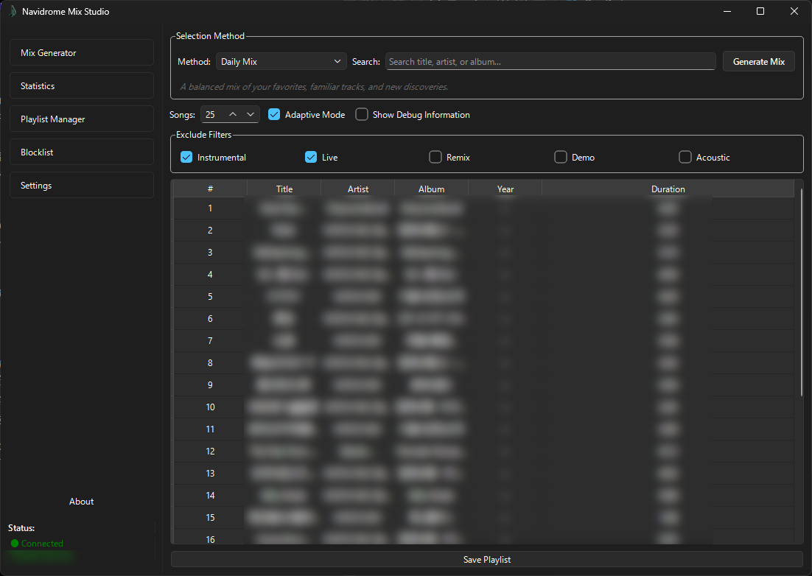
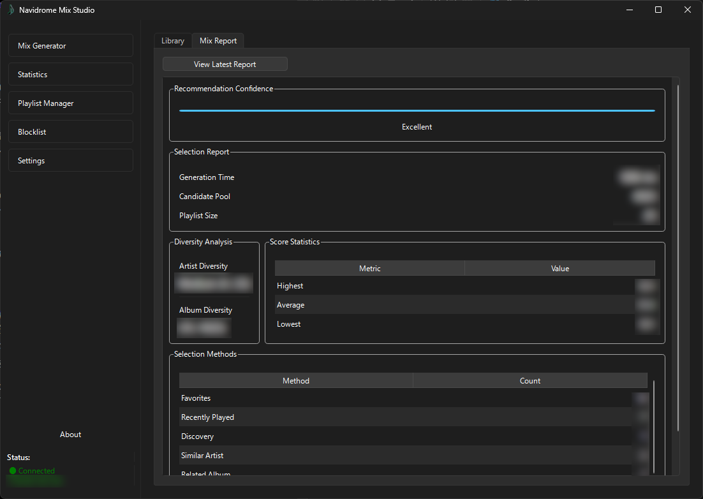
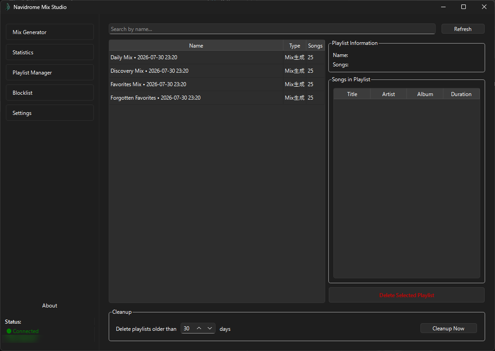
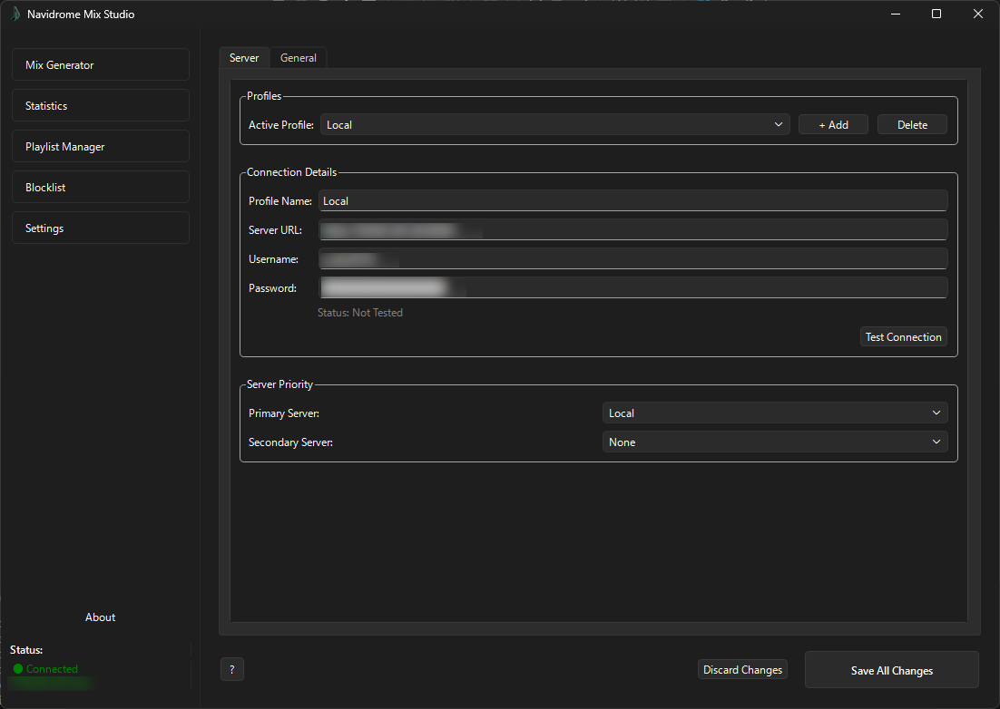
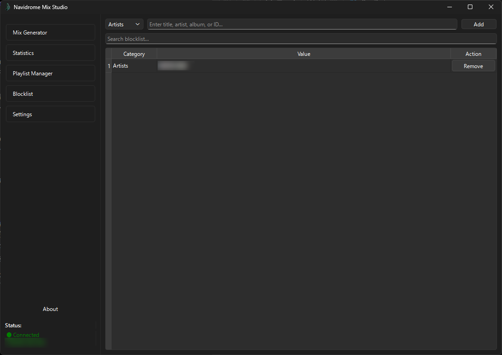
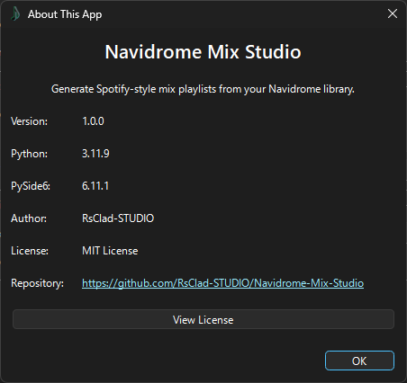

# Navidrome Mix Studio

> Create intelligent, personalized playlists from your own Navidrome music library.

Navidrome Mix Studio is a Windows desktop companion for [Navidrome](https://www.navidrome.org/). It analyzes your music library, favorites, listening history, and track metadata to generate balanced playlists without relying on simple shuffle playback.

The application connects to Navidrome through its Subsonic-compatible API. Your music files remain on your server; Mix Studio retrieves the information needed to build recommendations and saves generated playlists back to Navidrome.

---

## Highlights

- Four recommendation-based mix types
- Full-library retrieval with paginated API requests
- Recommendations informed by listening history, favorites, and library metadata
- Mix generation that can also work when listening history is empty
- Artist, album, and version diversity controls
- Playlist creation, update, browsing, and cleanup
- Library statistics and metadata analysis
- Blocklist support
- Server- and user-specific cache and mix-history separation
- English and Japanese interface
- Qt desktop interface with Light and Dark Mode support

---

## Screenshots

| Main Window | Statistics |
| --- | --- |
|  |  |

| Playlist Manager | Settings |
| --- | --- |
|  |  |

| Blocklist | About |
| --- | --- |
|  |  |

---

## Mix Types

| Mix | Description |
| --- | --- |
| **Daily Mix** | A balanced selection for everyday listening. |
| **Favorites Mix** | Builds around favorite tracks while maintaining variety. |
| **Discovery Mix** | Helps rediscover tracks you rarely play. |
| **Forgotten Favorites** | Brings older, long-unplayed favorites back into rotation. |

The recommendation pipeline combines candidate selection, filtering, scoring, and diversity controls. The aim is to keep recommendations relevant while avoiding a playlist dominated by the same artist, album, or version.

---

## Features

### Intelligent Mix Generation

Mixes are generated using information available from your Navidrome account, including:

- Listening history
- Favorite tracks
- Track, artist, and album metadata
- Last-played information where available

An empty listening history is treated differently from a failed history request. This allows the generator to handle accounts with no recorded plays without interpreting an API failure as a valid empty history.

### Full Library Retrieval

The application retrieves the music library through paginated Subsonic API requests and normalizes API responses that may represent a single item or a list. This avoids relying on a single limited response when working with larger libraries.

### Playlist Manager

Manage playlists from the desktop application:

- Browse playlists and view their tracks
- Search playlists
- Delete playlists
- Clean up generated playlists

When saving a Mix, repeated clicks are guarded against. In auto-update mode, an existing playlist with the same name is updated instead of creating another copy. If an update fails, the application does not silently create a duplicate playlist.

### Library Analysis

Review information about your collection, including library overview, artist and album distribution, favorites, metadata, and recommendation statistics.

### Blocklist

Exclude selected tracks from future recommendation results. The blocklist is applied across the recommendation types.

### Cache and Mix History Isolation

Cached library data, favorites, and Mix history are separated by Navidrome server and user context. This prevents data from one account or server from being reused as though it belonged to another.

Mix-history duplicate detection considers the preset and the set of track IDs. A different preset or a different track selection can be recorded as a separate Mix.

### Automatic Generation

The application includes a scheduler with startup, daily, and interval modes. It can generate a configured Mix and save it to Navidrome automatically. Scheduler behavior may depend on application runtime and local configuration; review the settings before enabling it.

### Languages and Appearance

The interface includes the following language resources:

- English
- Japanese
- Spanish
- French
- German
- Portuguese (Brazil)

Light and Dark Mode are also supported. Language changes are applied within the application.

---

## Requirements

| Component | Requirement |
| --- | --- |
| Operating System | Windows 10 / Windows 11 (64-bit) |
| Python | 3.11 or later (source run only) |
| GUI Framework | PySide6 |
| HTTP Client | requests |
| Music Server | Navidrome |
| API | Subsonic-compatible API |
| Network | Connectivity to your Navidrome server |

You will need the Navidrome server URL, username, and password for the account whose listening history and favorites should inform recommendations.

**Account selection matters:** use the same Navidrome account you normally use to listen to music. If you use a different account, its listening history and favorites may produce different recommendations.

---

## Installation

### Option 1 — Download a Release

1. Open the project's [GitHub Releases](https://github.com/RsClad-STUDIO/Navidrome-Mix-Studio/releases) page.
2. Download the latest available Windows release.
3. Extract the archive.
4. Launch the included executable.

A packaged release does not require a separate Python installation.

### Option 2 — Run from Source

Clone the repository:

```powershell
git clone https://github.com/RsClad-STUDIO/Navidrome-Mix-Studio.git
cd Navidrome-Mix-Studio
```

Create and activate a virtual environment:

```powershell
py -3.11 -m venv .venv
.\.venv\Scripts\Activate.ps1
```

Install dependencies:

```powershell
python -m pip install -r requirements.txt
```

Start the application:

```powershell
python main.py
```

The dependencies are listed in `requirements.txt`.

---

## Getting Started

### 1. Configure Navidrome

Open **Settings** and enter:

- Server URL
- Username
- Password

Save the settings.

### 2. Connect

Use the connection control to connect to your Navidrome server. Once connected, the application can retrieve the library and account data needed for Mix generation.

### 3. Load and Analyze Your Library

The application retrieves tracks and supporting information such as favorites and listening history. The analysis is used by the recommendation engine.

### 4. Generate a Mix

Choose one of the four Mix types, adjust the desired track count and available filters, then select **Generate**.

### 5. Review and Save

Review the generated tracks and save the Mix to Navidrome. The resulting playlist is available to other clients connected to the same Navidrome server.

---

## Important Notes

- Mix recommendations depend on the information available to the connected Navidrome account.
- A newly created or rarely used account may have little or no listening history. Mix generation can still use available library metadata and favorites.
- Cache and Mix-history data are scoped to the server and user context.
- Automatic generation requires the application and its scheduler to be running at the configured time.
- Keep your Navidrome server URL and credentials private. Do not publish configuration files containing credentials.

---

## Testing and Project Status

The current development branch has passed its automated Python test workflow:

- Python 3.11
- Python syntax compilation
- **56 automated tests passed**

Core integration behavior has also been checked against a live Navidrome instance with a library of **6,029 tracks**:

1. Standalone application launch
2. Navidrome connection
3. Full library retrieval
4. Mix generation
5. Mix generation with no play-count history (the previously observed unexpected six-track result)
6. Prevention of duplicate playlist creation

All six integration checks passed in that test environment. Results may vary with different Navidrome versions, server configurations, accounts, and libraries.

The project continues to receive maintenance and reliability improvements. A successful test run does not guarantee that every optional feature or environment has been exhaustively tested.

---

## Architecture

The codebase separates the desktop interface, API communication, application services, recommendation engine, data models, and translations.

Key design elements include:

- **API layer:** communication with Navidrome through the Subsonic-compatible API
- **Services:** library, history, playlist, cache, and scheduling operations
- **Recommendation engine:** candidate pipeline, filtering, scoring, and diversity controls
- **GUI:** Qt interface implemented with PySide6
- **Localization:** JSON translation resources with runtime language switching

This modular structure is intended to keep UI code, server communication, and recommendation logic independently maintainable.

---

## License

This project is licensed under the **MIT License**. See the [LICENSE](LICENSE) file for the full license text.

---

## Acknowledgements

- [Navidrome](https://www.navidrome.org/) — Self-hosted music server with a Subsonic-compatible API.
- [Qt](https://www.qt.io/) and [PySide6](https://doc.qt.io/qtforpython-6/) — Desktop application framework and Python bindings.
- [Python](https://www.python.org/) — Programming language and ecosystem.

Thank you to the open-source community and everyone who contributes through software, documentation, testing, and shared knowledge.
